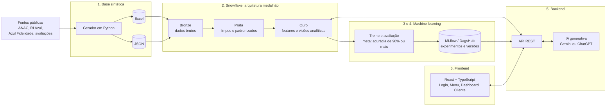
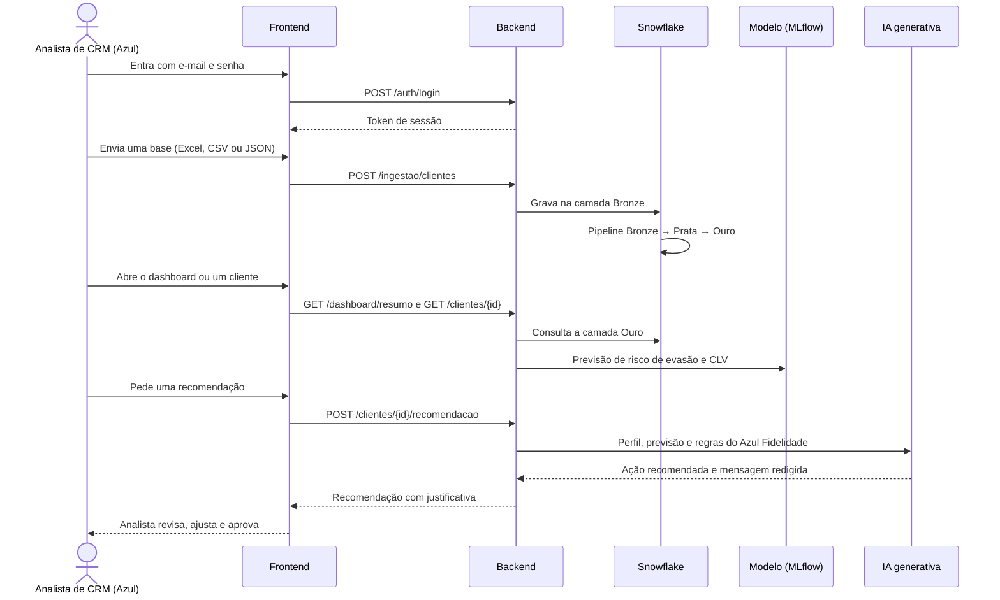

<h1 align="center">Hackathon Business - Azul - CRM Alto Valor <br>
</h1>

<h2 align="center" id="integrantes">👤👨‍🎓 Integrantes do Projeto: </h2>
<ul>
<li>Gabriel Meiki Maeda Taira <a href="" target="_blank"></a> <a href="" target="_blank"></a></li>
<li>Gustavo Geraldo Campos da Silva <a href="" target="_blank"></a> <a href="" target="_blank"></a></li>
<li>Julia Santos <a href="" target="_blank"></a> <a href="" target="_blank"></a></li>
<li>Lucas Paguetti Pereira <a href="https://www.linkedin.com/in/lucas-paguetti-pereira" target="_blank"></a> <a href="https://github.com/wqiluc" target="_blank"></a></li>
<li>Lucas Rodrigues Meza <a href="" target="_blank"></a> <a href="" target="_blank"></a></li>
</ul>

> 🔒 **Repositório privado.** O enunciado do desafio é confidencial; não publique este conteúdo.

<h2 align="center" id="sobre">🎯 Sobre o Projeto</h2>

**CRM de Alto Valor** é uma ferramenta **interna, para as equipes de CRM, Fidelidade e Relacionamento da Azul** (não para os passageiros). Ela ajuda essas equipes a:

- **Identificar** os clientes de alto valor com um score que combina valor monetário, frequência, recência e potencial futuro (CLV);
- **Antecipar** o risco de evasão com um modelo de machine learning explicável;
- **Agir** com uma recomendação personalizada por cliente, redigida por IA generativa e aprovada por um analista antes de qualquer envio.

Como não há acesso a dados reais, toda a solução roda sobre uma **base sintética** calibrada por fontes públicas (ANAC, RI da Azul, regulamento do Azul Fidelidade e avaliações públicas). A arquitetura foi desenhada para que essa base possa ser trocada por dados reais **sem reconstruir a solução**.

<h2 align="center" id="tecnologias"> ⛏️💻 Tecnologias Utilizadas: <br>

</h2>

<p align="center">


</p>

| Camada | Tecnologia | Status |
|---|---|---|
| Base sintética | Python, exportação em Excel (`.xlsx`) e JSON | A fazer |
| Dados | Snowflake, arquitetura medalhão (Bronze, Prata, Ouro) | A fazer |
| Machine learning | Python (biblioteca a definir), métricas e explicabilidade | A fazer |
| Gestão de modelos | MLflow ou DagsHub (experimentos, métricas e versões) | A fazer |
| Backend | API REST (framework a definir) integrada a Snowflake, MLflow e IA generativa | A fazer |
| IA generativa | Gemini ou ChatGPT | A fazer |
| Frontend | React 19, TypeScript, Vite, React Router, Recharts | ✅ Em andamento |


<h2 align="center" id="arquitetura">🏰 Arquitetura do Repositório <br>

</h2>

### Visão geral da solução



### Fluxo completo (etapa 7: integração)



### Ordem de desenvolvimento

Sequência definida na mentoria, priorizando primeiro o que resolve o problema da Azul. As pastas ficam dentro de `MVP-Hackathon-Business-Avanade-Azul/`.

| # | Etapa | Entregável | Pasta | Status |
|---|---|---|---|---|
| 1 | Base sintética | Clientes fictícios em pelo menos dois formatos (Excel e JSON) | `DADOS/` | A fazer |
| 2 | Pipeline no Snowflake | Camadas Bronze, Prata e Ouro, tratadas e documentadas | `SNOWFLAKE/` | A fazer |
| 3 | Modelo de ML | Treino e avaliação sobre a camada Ouro, com acurácia de 90% ou mais | `MODELO/` | A fazer |
| 4 | Gestão do modelo | Experimentos, métricas e versões no MLflow ou DagsHub | `MODELO/` | A fazer |
| 5 | Backend com IA | API que recebe dados do front, consulta o Snowflake, usa o modelo do MLflow e gera recomendações com IA generativa | `BACKEND/` | A fazer |
| 6 | Frontend | Dashboard e tela do cliente, com análises e recomendações da IA | `FRONTEND/` | ✅ Em andamento |
| 7 | Integração e testes | Fluxo completo validado, do envio de dados até a recomendação | todas | A fazer |

> O frontend foi adiantado com uma base sintética local que segue o mesmo contrato da API. Quando o backend existir, basta configurar `VITE_API_URL`; nenhuma tela muda.

### Estrutura de pastas

<pre>
MVP-Hackathon-Business-Avanade-Azul✈️/
├── MVP-Hackathon-Business-Avanade-Azul /
│   ├── DADOS    /
│   ├── SNOWFLAKE    /
│   ├── MODELO    /
│   ├── BACKEND   /
│   └── FRONTEND      /
│       ├── .env.example 
│       ├── .gitignore 
│       ├── .oxlintrc.json 
│       ├── README.md 
│       ├── index.html 
│       ├── package.json 
│       ├── package-lock.json 
│       ├── tsconfig.json 
│       ├── tsconfig.app.json 
│       ├── tsconfig.node.json 
│       ├── vite.config.ts 
│       ├── public /
│       │   └── favicon.svg 
│       └── src /
│           ├── principal.tsx 
│           ├── Aplicacao.tsx 
│           ├── paginas /
│           │   ├── PaginaLogin.tsx  
│           │   ├── PaginaLogin.css 
│           │   ├── PaginaMenu.tsx  
│           │   ├── PaginaMenu.css 
│           │   ├── PaginaDashboard.tsx  
│           │   └── PaginaCliente.tsx  
│           ├── componentes /
│           │   ├── cliente /
│           │   │   └── CartaoRecomendacaoIA.tsx 
│           │   ├── dashboard /
│           │   │   ├── SegmentosPersona.tsx 
│           │   │   └── TabelaPrioritarios.tsx 
│           │   ├── estrutura /
│           │   │   ├── LayoutPrincipal.tsx 
│           │   │   ├── RotaProtegida.tsx 
│           │   │   ├── BuscaCliente.tsx 
│           │   │   └── MenuUsuario.tsx 
│           │   ├── graficos /
│           │   │   ├── MatrizValorRisco.tsx 
│           │   │   ├── Explicabilidade.tsx 
│           │   │   ├── GraficoReceitaMensal.tsx 
│           │   │   ├── GraficoVoosMensais.tsx 
│           │   │   ├── ComposicaoCategorias.tsx 
│           │   │   ├── BarrasRanking.tsx 
│           │   │   ├── CartaoGrafico.tsx 
│           │   │   └── Legenda.tsx 
│           │   ├── ingestao /
│           │   │   └── EnvioBaseClientes.tsx 
│           │   ├── modelo /
│           │   │   └── AvisoModelo.tsx 
│           │   └── ui /
│           │       ├── Cartao.tsx 
│           │       ├── Indicador.tsx 
│           │       ├── Medidor.tsx 
│           │       ├── Selos.tsx 
│           │       ├── Icone.tsx 
│           │       └── cores.ts 
│           ├── servicos /
│           │   ├── fonteDeDados.ts 
│           │   ├── servicoCrm.ts 
│           │   ├── fonteSintetica.ts 
│           │   ├── fonteApi.ts 
│           │   ├── configuracaoApi.ts 
│           │   ├── servicoAutenticacao.ts 
│           │   └── sessao.ts 
│           ├── contextos /
│           │   ├── ProvedorAutenticacao.tsx 
│           │   └── contextoAutenticacao.ts 
│           ├── hooks /
│           │   ├── useAutenticacao.ts 
│           │   └── useBuscaAssincrona.ts 
│           ├── tipos /
│           │   ├── crm.ts 
│           │   └── autenticacao.ts 
│           ├── dados /
│           │   └── sinteticos /
│           │       └── gerarClientes.ts 
│           ├── configuracao /
│           │   ├── personas.ts 
│           │   ├── fidelidade.ts 
│           │   └── aeroportos.ts 
│           ├── utilitarios /
│           │   └── formatacao.ts 
│           ├── estilos /
│           │   └── global.css 
│           └── imagens /
│               └── logo-azul.jpg 
│
├── img /
│   └── Azul logo.jpg 
├── pdf /
│   └── Desafio_3_Azul_CrmAltoValor.pdf 
├── .gitignore 
└── README.md 
</pre>

### Contrato entre frontend e backend

O frontend consome apenas estes endpoints. Os formatos de resposta estão em [`FRONTEND/src/tipos/crm.ts`](MVP-Hackathon-Business-Avanade-Azul/FRONTEND/src/tipos/crm.ts) e o cliente HTTP em [`FRONTEND/src/servicos/fonteApi.ts`](MVP-Hackathon-Business-Avanade-Azul/FRONTEND/src/servicos/fonteApi.ts).

| Método | Rota | Uso no frontend | Origem dos dados |
|---|---|---|---|
| `POST` | `/auth/login` | Tela de login; o token vai em `Authorization: Bearer` nas demais chamadas | Cadastro de usuários internos |
| `GET` | `/dashboard/resumo?persona=&tier=` | Indicadores, matriz valor × risco, personas, categorias, atritos | Visões da camada Ouro |
| `GET` | `/clientes?persona=&tier=` | Busca e fila de prioridade | Camada Ouro + previsões |
| `GET` | `/clientes/{id}` | Tela do cliente (perfil, histórico, explicabilidade) | Camada Ouro + modelo |
| `POST` | `/clientes/{id}/recomendacao` | Botão "Gerar nova recomendação" | Modelo + IA generativa |
| `POST` | `/ingestao/clientes` | Envio de base (multipart, campo `arquivo`) | Grava na camada Bronze |
| `GET` | `/modelo` | Aviso de transparência (versão, acurácia, AUC) | MLflow / DagsHub |

### Premissas e IA responsável

- **Dados 100% sintéticos.** Nenhum dado real de cliente é usado; a tela exibe esse aviso o tempo todo.
- **CLV** é a receita projetada em 24 meses caso o cliente seja retido. **Perda esperada = CLV × risco de evasão**, que ordena a fila de prioridade.
- **Explicabilidade:** score de valor e risco são mostrados como soma de contribuições por fator (no estilo SHAP), para o analista entender cada previsão.
- **Segmentação sem vieses:** personas definidas só por comportamento de voo e relacionamento, sem gênero, idade, renda ou outros atributos sensíveis.
- **Humano no controle:** só usuários internos autenticados acessam a ferramenta; a IA sugere, o analista revisa e aprova, e a aprovação registra quem aprovou. Clientes sem consentimento de marketing têm o envio promocional bloqueado (LGPD).
- **Regras do Azul Fidelidade** (categorias, pontos qualificáveis) usadas como premissas ilustrativas; validar com o regulamento vigente antes de uso real.

### Como rodar o frontend

Pré-requisito: [Node.js](https://nodejs.org) 20.19+ ou 22.12+ (já inclui o `npm`). Para conferir: `node -v`.

```bash
cd MVP-Hackathon-Business-Avanade-Azul/FRONTEND
npm install        # só na primeira vez
npm run dev        # abre em http://localhost:5173
```

Abra http://localhost:5173 no navegador e entre com um dos acessos de demonstração:

| Perfil | E-mail | Senha |
|---|---|---|
| Analista | `analista@exemplo.com` | `azul2026` |
| Gestor | `gestor@exemplo.com` | `azul2026` |

> Esses acessos são **exemplos** e só funcionam no modo de demonstração (sem backend), usando a base sintética. Com o backend configurado em `VITE_API_URL` (arquivo `.env`, ver `.env.example`), o login passa a ser validado pela API em `POST /auth/login`.

Outros comandos, executados dentro de `FRONTEND/`:

| Comando | O que faz |
|---|---|
| `npm run build` | Checa os tipos e gera a versão de produção em `dist/` |
| `npm run preview` | Serve a versão de produção localmente |
| `npm run lint` | Verifica o código com o oxlint |

Mais detalhes em [`FRONTEND/README.md`](MVP-Hackathon-Business-Avanade-Azul/FRONTEND/README.md).
